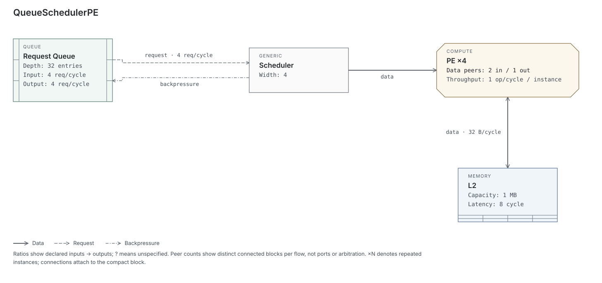

# Drarch

**Computer architecture diagrams as code.**

Describe queues, compute units, memories, and their connections in a `.drarch` file. Drarch validates the architecture, lays out the diagram, and produces an interactive HTML file or a static SVG. No coordinates, server, or network connection are required to view the result.

The goal is to help a computer architect externalize a correct mental model in minutes, then refine it through small, reviewable source changes.

[Quick start](#quick-start) · [Using the viewer](#using-the-viewer) · [Examples](#examples) · [Language reference](docs/language.md) · [Design principles](#design-principles)



The [queue / scheduler / PE source](examples/queue_scheduler_pe.drarch) produces this diagram. The HTML viewer also provides search, linked properties, and connection highlighting.

**Status:** The first implementation is available. Drarch uses JavaScript on Node.js 20+ and the [ELK layout engine](https://github.com/kieler/elkjs). It includes the compiler, typed validation, canonical formatter, JSON inspection, automatic layout, standalone HTML viewer, static SVG export, and six example architectures. The specification below continues to describe the product goals; the [language reference](docs/language.md) records the implemented schemas, syntax, and current limits.

## Quick start

From this checkout, with Node.js 20 or newer:

```bash
npm install
node bin/drarch.js check examples/queue_scheduler_pe.drarch
node bin/drarch.js render examples/queue_scheduler_pe.drarch
```

Open `examples/queue_scheduler_pe.html` directly in a browser. Select a block or connection to inspect its properties. Use **Fit diagram** for the full architecture, **Actual size** to read its text, or **Find a block** to jump to a component.

```bash
# Inspect the semantic model, preserving written numbers and units.
node bin/drarch.js inspect examples/npu.drarch --json

# Format a source file in place, or verify formatting without modifying it.
node bin/drarch.js fmt examples/npu.drarch
node bin/drarch.js fmt examples/npu.drarch --check

# Export a static figure.
node bin/drarch.js render examples/npu.drarch --format svg -o npu.svg

# Run tests and render all six examples into output/.
npm test
npm run examples
```

Open `output/index.html` to browse all generated examples and their SVG exports.

To expose the shorter `drarch` command while developing, run `npm link` from this checkout. No build step is required. For a clean install from the lockfile, use `npm ci`; a runtime-only install can use `npm ci --omit=dev`.

Tests cover compiler diagnostics, formatting round trips, CLI behavior, deterministic layout, group containment, edge endpoints, SVG rasterization, and viewer events in a DOM test environment. Browser compatibility and dense-diagram visual quality still need broader testing. Column lists containing groups remain soft preferences; component-only lists support vertical stacking, including a connected memory below a compute array.

## Using the viewer

The diagram occupies a scrollable canvas; the sidebar contains search and the inspector. Search matches names, qualified IDs such as `execution.array.pe`, and component types. Selecting a result brings the block into view at actual size or your larger zoom level. Selecting a group fits that group into view.

Select a component to highlight its connected paths. The inspector lists its connections and links to its parent group. Select a connection to follow its **From** and **To** links. The **Flow legend** explains the line patterns used in the current diagram. On a narrow screen, the sidebar sits below the canvas; **View details** jumps to the inspector.

| Action | Keyboard |
| --- | --- |
| Find a block | `/` |
| Select the first search result | `Enter` in the search field |
| Fit the entire diagram | `F` |
| Actual size | `0` |
| Zoom in / out | `+` / `-` |
| Focus and select a diagram element | `Tab`, then `Enter` or `Space` |
| Return to architecture details | `Escape` or **Overview** |

Shortcuts do not interrupt typing or browser shortcuts. Escape clears an active search first. Fit responds to canvas resizing; manual zoom stays at the chosen scale. Very large architectures are small in overview—use search to inspect a subsystem. Without JavaScript, the diagram, architecture description, counts, and flow legend remain available.

## Examples

Run `npm run examples`, then open `output/index.html`. Each source produces an offline HTML viewer and an SVG.

| Source | What it demonstrates |
| --- | --- |
| [Queue / scheduler / PE](examples/queue_scheduler_pe.drarch) | A small request path, upstream backpressure, and memory below compute |
| [CPU pipeline](examples/cpu_pipeline.drarch) | Five pipeline stages and issue width |
| [Cache hierarchy](examples/cache_hierarchy.drarch) | Memory hierarchy and bandwidth |
| [NPU](examples/npu.drarch) | Compute arrays and local storage |
| [Network on chip](examples/noc.drarch) | Routing and multiple connections |
| [Nested accelerator](examples/nested_accelerator.drarch) | Groups and qualified references |

The sections below explain the product design and longer-term goals. The [language reference](docs/language.md) is the source for implemented syntax and current limits.

## Why Drarch?

Architecture reasoning depends on more than boxes and arrows. A useful diagram communicates data movement, resource capacity, throughput, latency, dependencies, contention, and backpressure.

Drarch aims to combine the simplicity of diagrams as code with a semantic model of computer architecture. A queue has depth and input/output rates; a compute unit has throughput; a memory has capacity, bandwidth, and latency. A generic named block can describe a scheduler, controller, or other function. Those properties guide validation and presentation.

The primary workflow is:

```text
Think → Describe → Render → Inspect → Modify → Render again
```

The first goal is **text → a clear, clean, refined computer architecture diagram**. Users should be able to express block order and rough placement while the renderer handles spacing, sizing, alignment, and routing. Additional analysis features follow after the diagram workflow meets this goal.

## Example

The language describes an accelerator as follows:

```text
arch Accelerator {
    queue input_q {
        label: "Input Queue"
        desc: "Holds requests waiting for the scheduler."
        depth: 32
        input_bw: 4 req/cycle
        output_bw: 2 req/cycle
    }

    generic sched {
        label: "Scheduler"
        width: 2
        latency: 2 cycle
    }

    compute pe {
        label: "PE"
        count: 4
        throughput: 1 op/cycle
    }

    memory sram {
        capacity: 512 KB
        bandwidth: 32 B/cycle
        latency: 4 cycle
    }

    input_q -> sched {
        rate: 2 req/cycle
    }

    sched -> pe {
        rate: 1.7 op/cycle
    }

    pe <-> sram {
        bandwidth: 28 B/cycle
    }
}
```

The intended diagram shows the input queue, scheduler, PE array, and SRAM with their useful architectural properties and annotated flows. The renderer infers their left-to-right order from the connections and chooses positions, spacing, box sizes, and edge routes automatically. Repeated hardware such as `count: 4` appears as one compact `PE ×4` block. Its `throughput: 1 op/cycle` describes each PE, so the diagram should identify that value as per PE rather than as the array's total throughput.

The default output is a standalone HTML file. Users can inspect descriptions and additional properties without placing all of that text inside the diagram.

## Design principles

- **Describe architecture semantically.** Use component types and properties instead of rectangles and coordinates.
- **Prioritize diagram quality.** Establish clear composition and refined visual output before adding architecture analysis.
- **Use general architectural primitives.** Give storage, computation, and routing blocks useful defaults. Represent specialized functions as generic named blocks.
- **Allow relative layout hints.** Infer default order from connections, and let users suggest order, columns, and parallel arrangements. The renderer may adjust these preferences to keep the diagram readable.
- **Support architectural reasoning.** Emphasize capacity, concurrency, movement, constraints, and hierarchy. Hide RTL-level detail by default.
- **Make source easy for AI agents to edit.** Use stable identifiers, explicit units, deterministic syntax, canonical formatting, and actionable diagnostics.
- **Provide useful defaults.** A valid source file should produce a readable diagram without manual alignment or routing.
- **Keep the semantic model independent of rendering.** Preserve architecture information in an intermediate representation that other tools can consume.

## Language

Files use the `.drarch` extension. An `arch` block contains components, connections, and optional nested `group` blocks. Simple `//` comments are supported in the v0 design.

### Components

The v0 component list uses general storage, computation, and routing primitives. Each built-in primitive has a predefined property schema and rejects unsupported architectural properties. Only `generic` accepts arbitrary custom architectural properties. The table gives examples; the complete schemas and value rules are in the [language reference](docs/language.md#properties):

| Type | Architectural role | Example properties |
| --- | --- | --- |
| `queue` | Buffered entries or requests | `depth`, `input_bw`, `output_bw` |
| `buffer` | Temporary storage | `capacity`, `read_bw`, `write_bw`, `latency` |
| `register` | A register or bank of registers holding state | `width`, `count` |
| `compute` | Execution units or an array of units | `count`, `throughput`, `latency` |
| `memory` | SRAM, DRAM, ROM, a cache, or another storage block | `kind`, `capacity`, `bandwidth`, `read_bw`, `write_bw`, `latency`, `line_size` |
| `mux` | Select one of several inputs for an output | `inputs`, `width`, `latency` |
| `demux` | Route an input to one of several outputs | `outputs`, `width`, `latency` |
| `crossbar` | Route among multiple inputs and outputs | `inputs`, `outputs`, `width`, `bandwidth`, `latency` |
| `generic` | A named function such as a scheduler, arbiter, controller, or pipeline stage | `label` and architectural attributes such as `width`, `policy`, `stages`, `throughput`, or `latency` |

Every architecture, group, component, and connection supports a `desc` field. Descriptions may be empty or omitted; an omitted description is treated as empty. Components also support a display `label`, with the component ID used when no label is supplied. Description text belongs in the inspection view rather than inside every block.

Common presentation fields such as `label`, `desc`, and `display` are separate from architectural properties. Allowing these fields on primitives does not allow arbitrary custom architectural properties. Known architectural fields, such as `latency`, retain their type and unit checks when used on `generic`; a custom property is preserved without inventing architectural meaning for its name.

Schedulers and pipelines use `generic` rather than dedicated component types. A cache uses `memory`, for example with `kind: cache` and `label: "L2"`. An ALU uses `compute` with an appropriate label.

A mux selects a data input, a demux selects a data output, and an arbiter decides which competing requester receives a grant. An arbiter can therefore appear as a generic block controlling a mux; the functions should remain distinct.

Interconnect is an umbrella term for communication structures, including buses, crossbars, and networks-on-chip. The component list uses the more specific `crossbar`; a bus or network-on-chip can initially use a generic named block or a group of routing blocks.

Repeated hardware declared with `count` renders as one compact block by default. For example, `compute pe { count: 4 }` appears as `PE ×4`. Compute throughput applies to each instance. A connection to `pe` attaches to the compact array block; rendering does not create separate per-instance connections or multiply the flow's annotated rate.

Users can declare distinct blocks such as `pe0` and `pe1` when those blocks need separate connections or properties. Layout hints can place these distinct blocks vertically in the same column. The default `count` representation remains collapsed.

### Default property display

Each primitive chooses a concise set of architectural properties to show when those properties are present. Other properties remain available in the HTML inspection view. The default visible fields are:

| Primitive | Default visible properties |
| --- | --- |
| `queue` | `depth`, `input_bw`, `output_bw` |
| `buffer` | `capacity`, `read_bw`, `write_bw`, `latency` |
| `register` | `width`, `count` |
| `compute` | `count`, per-instance `throughput`, `latency` |
| `memory` | `capacity`, `bandwidth` or directional `read_bw` / `write_bw`, `latency` |
| `mux` | `inputs`, `width` |
| `demux` | `outputs`, `width` |
| `crossbar` | `inputs`, `outputs`, `bandwidth` |
| `generic` | Label only; users select any additional visible properties |

Counts can appear in the block heading, such as `PE ×4`, rather than as a duplicate property line. Display choices change presentation without changing the underlying values.

Users can override the visible fields with a `display` list:

```text
memory sram {
    capacity: 512 KB
    bandwidth: 32 B/cycle
    latency: 4 cycle
    display: [capacity, latency]
}
```

This shows capacity and latency inside the block while retaining bandwidth in the inspection view. An empty display list shows only the label. Each listed property must be present on the element.

### Connections and flow types

Connections can be directed, bidirectional, or annotated:

```text
a -> b
a <-> b

a -> b {
    type: data
    bandwidth: 32 B/cycle
    latency: 2 cycle
}
```

Connections attach to whole blocks. Users can connect any declared blocks without defining ports, pin names, or separate read/write endpoints. Multiple connections between the same pair of blocks are allowed. The renderer chooses attachment points and routes each edge; these drawing positions do not become named endpoints in the source.

Validation checks that referenced blocks exist. It does not restrict which primitive types may connect or infer connection limits from properties such as `inputs` and `outputs`. A qualified reference such as `execution.pe` identifies a block inside a group, not a port.

An explicit flow `type` is optional. Units identify the quantity carried by a rate or bandwidth, but do not establish the relationship's meaning: requests and responses can both use `req/cycle`, and data and control can both use `B/cycle`. A connection without a type receives a neutral visual style.

When specified, the flow types are `data`, `request`, `response`, `control`, `backpressure`, `credit`, and `dependency`. The renderer distinguishes them with restrained edge styles.

For example, a scheduler can signal backpressure to an upstream queue:

```text
sched -> input_q {
    type: backpressure
}
```

### Typed units

Units carry semantic meaning and participate in validation:

| Quantity | Example values |
| --- | --- |
| Bandwidth | `32 B/cycle`, `128 GB/s` |
| Throughput or request rate | `4 op/cycle`, `2 req/cycle` |
| Latency | `4 cycle`, `40 ns` |
| Storage capacity | `512 KB`, `8 MB` |
| Entry count | `32 entries` |
| Interconnect width | `256 bit` |

Properties must receive values with the appropriate units. For example, `latency: 32 GB/s` is invalid because bandwidth cannot express latency; `capacity: 4 op/cycle` is invalid because throughput cannot express storage capacity.

Drarch preserves the written numeric values and units in its semantic model and diagram. It records the quantity type for validation but does not convert or compare per-cycle and per-second rates. For example, `32 B/cycle` and `128 GB/s` remain as written, without requiring a clock frequency or claiming that either rate is larger. Cycle-based and time-based latencies also remain distinct.

### Hierarchy

Groups describe architectural subsystems. Qualified references connect components across groups:

```text
arch NPU {
    group frontend {
        queue iq {
            depth: 32
        }

        generic sched {
            label: "Scheduler"
            width: 2
        }

        iq -> sched
    }

    group execution {
        compute pe {
            count: 8
        }

        memory local_sram {
            capacity: 1 MB
        }

        pe <-> local_sram
    }

    frontend.sched -> execution.pe
}
```

The diagram should preserve these subsystem boundaries and keep related components close together.

### Canonical formatting and diagnostics

The formatter should normalize whitespace and property ordering so equivalent programs converge toward nearly identical formatting. This makes generated source predictable and keeps Git diffs small. Formatting does not change numeric values or convert unit scales.

Validation must detect invalid syntax, duplicate IDs, missing components, invalid references, invalid units, unsupported architectural properties on primitives, invalid values for known fields, and malformed hierarchy. Custom properties on `generic` are valid. Diagnostics should include an error code, source location, highlighted source, and a useful explanation or suggestion.

Illustrative diagnostic:

```text
error[DRARCH201]: unknown component

  accelerator.drarch:18:10

18 | sched -> pes
              ^^^

Did you mean `pe`?
```

Architecture analysis, including semantic warnings about capacity or utilization bounds, follows the diagram-focused MVP. Drarch must not make unsupported performance claims.

## CLI

After `npm link`, the commands are:

```bash
# Validate syntax, references, properties, and units.
drarch check accelerator.drarch

# Apply canonical formatting.
drarch fmt accelerator.drarch

# Render to accelerator.html by default.
drarch render accelerator.drarch

# Export the diagram as a static SVG.
drarch render accelerator.drarch --format svg

# Inspect the semantic model.
drarch inspect accelerator.drarch
drarch inspect accelerator.drarch --json
```

Standalone HTML is the default output. SVG is an optional output format selected with `--format svg`, and support for that export is part of the MVP. PNG output remains a possible later addition.

`render` also accepts `-o <output>` or `--output <output>`. `fmt --stdout` prints formatted source without modifying it; `fmt --check` exits with status 1 if formatting would change the source. Invalid input returns status 1 with source diagnostics. Run `drarch --help` for usage.

### Standalone HTML output

The generated HTML file contains the diagram as inline SVG, embedded styles, interaction code, descriptions, and properties. It opens locally without a server, external assets, or network requests. HTML permits SVG to be embedded directly in the document ([HTML Standard](https://html.spec.whatwg.org/multipage/embedded-content-other.html#svg-0)).

The viewer shows short descriptions on hover or keyboard focus and full descriptions and properties when an element is selected. An empty description does not produce an empty tooltip; the user can still inspect the element's properties. Inspection does not resize blocks or rearrange the diagram. The diagram remains readable when no element is selected. SVG remains a static export for documents and presentations.

This interactive viewer is part of the diagram-focused MVP. A browser-based source editor and manual canvas editing remain outside that scope.

## Compiler and rendering architecture

The compiler turns source into a validated architecture model before rendering:

```text
.drarch source
      ↓
Lexer → Parser → AST
                  ↓
           Semantic analyzer
                  ↓
              Drarch IR
             /         \
            ↓           ↓
       Diagnostics   Renderer
                        ↓
                    Layout IR
                        ↓
                   Layout engine
                        ↓
                       SVG ──→ Static SVG export
                        ↓
                Standalone HTML viewer
```

AST means abstract syntax tree: the parsed structure of the source. IR means intermediate representation: the normalized model used between compiler stages.

**Drarch IR is the central abstraction.** The parser's output is analyzed and lowered into this model, and the renderer consumes the model without depending on parser internals.

The IR must provide stable component IDs, preserved source locations, typed quantities with their written values and units, explicit hierarchy, descriptions, display preferences, deterministic representation, and clean JSON serialization. It retains custom properties from `generic` blocks. Renderer-specific coordinates belong outside the semantic IR; relative layout hints can be carried as presentation metadata for lowering into Layout IR.

After the diagram workflow is established, the semantic model can support additional analysis through five concepts:

| Concept | Meaning | Examples |
| --- | --- | --- |
| Component | A logical hardware block | Queue, memory, compute unit, routing block |
| State | Persistent or buffered information | Queue entries, cache contents, outstanding requests |
| Resource | A finite capability | Issue slots, execution lanes, ports, bandwidth |
| Flow | Movement between components | Requests, responses, bytes, credits, control |
| Constraint | A limit on a resource or flow | Capacity, latency, dependency, arbitration, backpressure |

These concepts guide future extensions; the MVP remains focused on component declarations, typed properties, hierarchy, and flows.

### Layout and visual language

Drarch uses ELK for layout and routing. A separate Layout IR keeps the backend replaceable.

Default architecture flow runs left to right within each architecture or group. The renderer infers order from connections rather than declaration order. Disconnected blocks and graphs with ambiguous ordering use a deterministic fallback so repeated renders remain predictable.

Users can suggest block order and rough columns, with distinct parallel blocks stacked vertically in the same column. These arrangements are soft layout hints: the renderer may adjust them to improve routing and readability. They describe presentation rather than new connections. The layout engine handles exact positions and edge routes.

The implemented syntax is:

```text
layout {
    columns: [input_q, sched, [pe0, pe1, pe2, pe3], sram]
}
```

Outer entries suggest columns from left to right. The nested list suggests blocks in one column from top to bottom. Each name refers to a declared direct child of the scope; this layout statement creates neither components nor connections. Here `pe0` through `pe3` are four separately declared blocks, whereas a single `pe` with `count: 4` remains one compact block. Put another layout block inside a group to arrange that group's children.

Layout priorities, in order, are to:

1. Prefer suggested block order and parallel-column arrangements while allowing adjustments for readability.
2. Preserve primary flow direction and hierarchy.
3. Minimize edge crossings.
4. Keep related components close.
5. Maintain useful symmetry.
6. Keep labels readable.
7. Keep small edits visually stable.

Diagrams should resemble clean technical-paper figures: a light background, monochrome-first styling, thin lines, and restrained typography, without gradients, shadows, decorative icons, or rainbow coloring.

The renderer shows useful architectural information by default, supports user overrides of visible properties, and retains the full property set in the semantic model and HTML inspection view. Normal diagrams must require no manual coordinate adjustments.

## MVP scope

The MVP contains four layers:

| Layer | Required capabilities |
| --- | --- |
| Language | `arch`, `group`, the nine component types, whole-block connections using `->` and `<->`, optional descriptions, typed primitive properties, custom properties on `generic`, layout hints, display overrides, and comments |
| Compiler | Parser, AST, semantic validation, typed units, Drarch IR, canonical formatter, and diagnostics |
| Renderer | Connection-based automatic layout with soft order and parallel-column hints, compact repeated blocks, editable property display defaults, component-specific styling, semantic edge styling, group containers, standalone HTML inspection, and SVG export |
| CLI | `check`, `fmt`, `render`, and `inspect` |

### Required examples

The repository should include six representative architectures:

1. **CPU pipeline:** fetch, decode, issue, execute, and commit.
2. **Cache hierarchy:** CPU, L1, L2, and DRAM.
3. **NPU:** input queue, scheduler, PE array, local SRAM, and DRAM.
4. **NoC system:** CPU, NPU, and DSP connected through a network-on-chip to a memory controller and DRAM.
5. **Queue / scheduler / PE:** queue depth, scheduling width, compute capacity, data flow, and backpressure.
6. **Nested accelerator:** groups and hierarchical references.

### Definition of done

Drarch v0 is complete when:

- A realistic small CPU or accelerator datapath can be described in approximately 20–60 lines.
- Ordinary diagrams render with zero manual coordinate adjustments.
- Default block order follows connections, and optional layout hints can influence composition without becoming mandatory constraints.
- Repeated compute units appear as a compact block with throughput identified as per instance.
- A small property change, such as changing queue depth from 16 to 32, does not randomly rearrange the architecture.
- Validation detects required syntax, reference, primitive-property, known-value, unit, and hierarchy errors while accepting custom properties on `generic`.
- A coding agent can safely edit a `.drarch` file without understanding graphical coordinates.
- Standalone HTML opens offline and lets users inspect descriptions and properties without disturbing the diagram's composition.
- Primitives have useful default visible properties, and users can override those selections.
- Values and units remain as written, without implicit conversion between cycles and elapsed time.
- SVG export is suitable for design documents, README files, architecture reviews, papers, and presentations.

The core product test is an agent editing an existing architecture to add a 32-entry request queue before a generic block labeled Scheduler, change that block to 4-wide, add an 8-cycle memory labeled L2 below the compute array, and show backpressure from the scheduler to the queue. Running `drarch check` and `drarch render` must then produce a valid, readable diagram without pixel-coordinate edits.

### Non-goals and deferred features

The MVP does not include simulation, performance prediction, occupancy simulation, roofline analysis, RTL parsing or generation, circuit schematics, floorplanning, trace visualization, waveforms, or animations.

Graphical authoring tools, browser-based source editors, VS Code extensions, manual canvas editing, AI chat interfaces, and an MCP server are also deferred. The standalone HTML inspection viewer is included in the MVP. Named connection ports are outside the MVP. Drarch is not intended as an EDA suite, an IP-XACT replacement, or a generic diagramming-tool replacement.

## Repository structure

The compiler and renderer are separate modules. `compile(source)` returns the semantic model; `render(model, { format: 'html' })` renders it without reading parser internals.

```text
drarch/
├── bin/drarch.js          # CLI entry point
├── src/
│   ├── index.js           # Public compile, format, render API
│   ├── parser.js          # Lexer, AST, source locations
│   ├── semantic.js        # Validation and semantic IR
│   ├── schema.js          # Primitive schemas and display defaults
│   ├── units.js           # Typed quantities; no conversion
│   ├── formatter.js
│   ├── diagnostics.js
│   ├── layout.js          # Layout IR and ELK adapter
│   └── renderer/          # SVG output and offline HTML viewer
├── docs/language.md
├── scripts/render-examples.js
├── examples/
│   ├── cpu_pipeline.drarch
│   ├── cache_hierarchy.drarch
│   ├── npu.drarch
│   ├── noc.drarch
│   ├── queue_scheduler_pe.drarch
│   └── nested_accelerator.drarch
├── tests/                 # Node test runner, jsdom, SVG raster checks
└── package.json
```

## Post-MVP roadmap

| Version | Focus | Planned additions |
| --- | --- | --- |
| v0.2 | Better architecture semantics | Explicit resources, ports, constraints, dependencies, and stronger static semantic linting |
| v0.3 | Scenarios and measurements | Scenario input rates and observed values, with a visual distinction between architectural capacity and observed behavior |
| v0.4 | Static analysis | Simple deterministic capacity, bandwidth, and utilization bounds without full simulation |
| v0.5 | AI integration | `drarch mcp` and structured tools for agents to inspect, validate, render, and modify models |

## Long-term STC-Sim integration

Drarch IR is intended to become the shared boundary between Drarch and STC-Sim:

```text
Drarch source → Drarch IR → Renderer
                   ↓
                STC-Sim
                   ↓
           Runtime statistics
                   ↓
           Visualization layer
```

Drarch owns structure, hierarchy, components, resources, flows, constraints, static properties, and visualization. STC-Sim owns runtime state, cycles, events, scheduling, execution, resource contention, and performance statistics.

STC-Sim could eventually supply queue occupancy, flow rates, utilization, stall reasons, latency, and backpressure for visualization. That integration must preserve the separation between the architecture model and runtime behavior.

The long-term aim is an AI-readable architecture representation that connects human reasoning, documentation, agents, and simulation topology. The primary success metric remains **how quickly a computer architect can externalize a correct mental model**.
